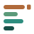
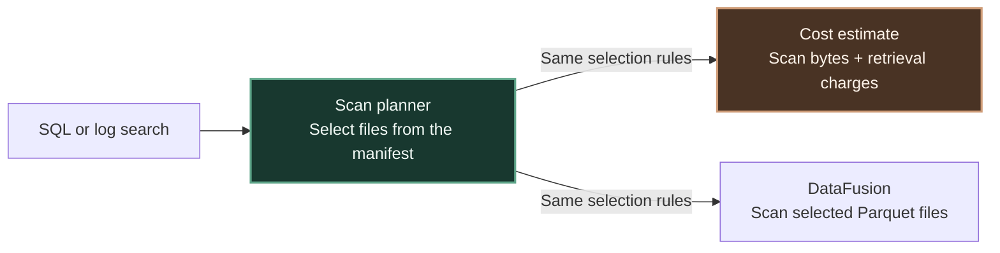

<div align="center">



# Verdigris

**Self-hosted log storage and SQL query for S3**

Store logs as Parquet in your own bucket. Query them with Apache DataFusion and
estimate scan size and retrieval charges before a query runs.

[](https://github.com/explise/verdigris/actions/workflows/rust.yml)
[](#project-status)
[](LICENSE)

[Quickstart](#quickstart) · [Architecture](#architecture) ·
[Documentation](https://explise.github.io/verdigris/) · [Deployment](#deployment)

</div>

## Quickstart

From the repository root, build the Logs explorer with Node.js 20 and start
Verdigris with local filesystem storage.

```bash
npm --prefix web ci
npm --prefix web run build
cargo run -p vdg --features serve -- serve --table logs --frontend web/dist
```

In a second terminal, generate a stream of sample logs.

```bash
cargo run -p vdg --features serve -- ingest --table logs --follow
```

Open the [Logs explorer](http://localhost:8080) and run a query over the last
hour. The local demo works without an AWS account. [Step-by-step guide](docs/getting-started.md)

## Architecture

The operator's bucket holds the Parquet files and the JSON manifest that
catalogs them. A single `vdg` binary can serve both paths. A split deployment
runs one ingest writer and scales query replicas independently.

```mermaid
flowchart LR
    accTitle: Verdigris deployment
    accDescr: Collectors send logs to the ingest writer, which writes Parquet and a manifest to S3. Query replicas read selected files and return results to clients.
    Collect["Log collectors<br/>Vector · Fluent Bit · OpenTelemetry"]
    Ingest["Verdigris ingest<br/>Batch · route · encode"]
    Bucket[("Your S3 bucket<br/>Parquet + manifest")]
    Query["Verdigris query<br/>Plan scans · execute SQL"]
    Clients["Query clients<br/>Logs explorer · API · Grafana"]

    Collect -->|HTTP logs| Ingest
    Ingest -->|Write files and commit manifest| Bucket
    Bucket -->|Read selected files| Query
    Query -->|Return results| Clients

    classDef role fill:#18382f,stroke:#5fa68a,color:#f2faf6,stroke-width:2px;
    classDef store fill:#493324,stroke:#cf9c77,color:#fff4ea,stroke-width:2px;
    class Ingest,Query role;
    class Bucket store;
```



Ingest writes content-addressed, Zstandard-compressed Parquet and publishes
file metadata using a conditional manifest update. Background compaction
merges small files by tier. SQL and the optional search syntax share the same
file-selection logic for estimating and executing a scan.



S3 lifecycle rules control storage classes and retention. Objects in storage
classes that require restoration must be made readable before Verdigris can
query them. [Architecture guide](docs/ARCHITECTURE.md) · [Cost and tiering](docs/cost.md) · [Architecture decisions](docs/adr/)

## Capabilities

| Area | What Verdigris provides |
| --- | --- |
| Collection | HTTP JSON/NDJSON and OTLP/HTTP JSON logs with backpressure |
| Storage | Tiered Parquet, per-file statistics, bloom filters, and background compaction |
| Query | DataFusion SQL, log search syntax, JSON and Arrow IPC results, and live tail |
| Operations | Scan estimates, SQL alerts with webhooks, Prometheus metrics, and a Grafana datasource |
| Access | Revocable API tokens, role-based access, and query audit history |

See the [HTTP API reference](docs/API.md) for endpoints and response formats.

## Deployment

The Helm chart supports EKS with S3 and a local MinIO deployment. The EKS guide
covers IAM Roles for Service Accounts, image configuration, and collector
setup. For local storage, S3, or an S3-compatible endpoint, see the storage
settings in [verdigris.toml](config/verdigris.toml).

[EKS installation](docs/install.md) · [Helm and MinIO examples](deploy/README.md) ·
[Configuration reference](docs/configuration.md)

## Project status

Verdigris is **alpha**. The local ingest and query loop works end to end, and
the Helm chart supports split ingest and query roles. Benchmark results and
targets are workload-specific. Deterministic simulation covers control-plane
behavior and fault handling. Throughput and latency are measured separately
with real workloads.

- [Roadmap](ROADMAP.md) for planned work and known gaps
- [Benchmark methodology and matched log comparison](https://github.com/explise/verdigris/issues/63)
- [Sustained ingest targets and results](https://github.com/explise/verdigris/issues/21)

## Contributing

Read the [contributing guide](docs/contributing.md) for build instructions and
the [simulation architecture](docs/dst-architecture.md) for the interfaces
that keep time, storage, scan execution, and randomness testable. Run the
repository's verification entry point before pushing.

```bash
scripts/verify.sh --all
```

## License

[Apache License 2.0](LICENSE). See [NOTICE](NOTICE) for third-party attribution.
